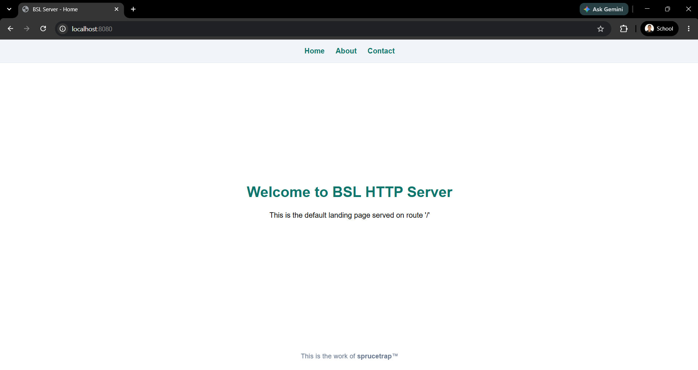
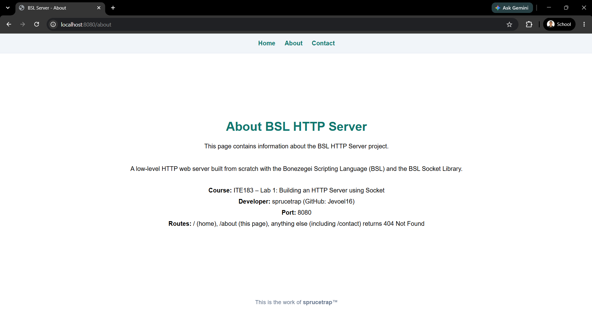
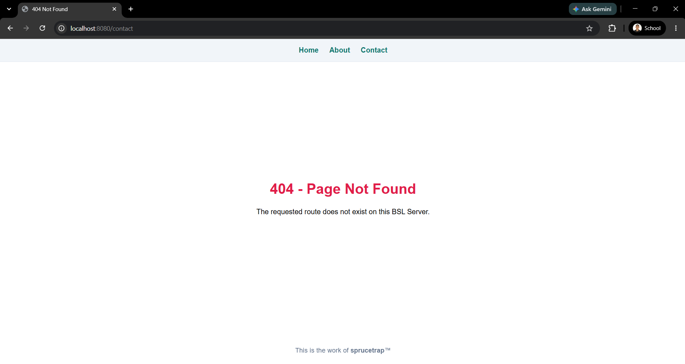
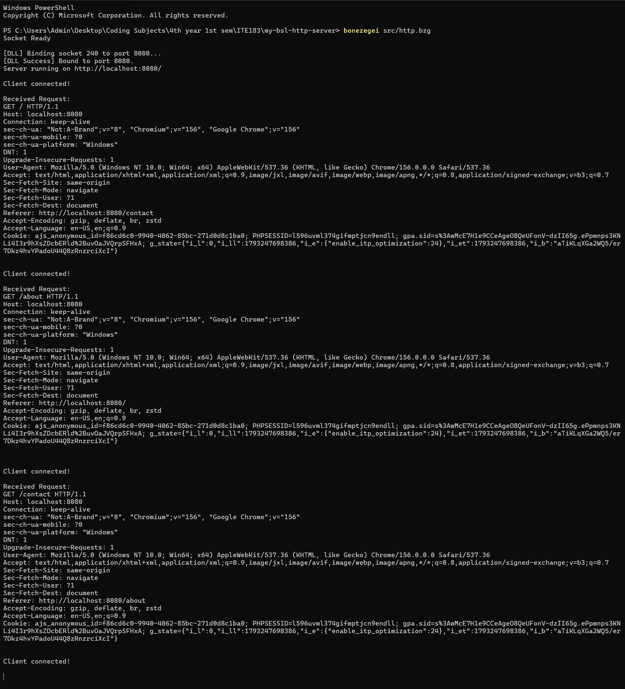

# Project Description

A low-level HTTP Web Server built from scratch using the Bonezegei Scripting Language (BSL) and the BSL Socket Library developed by Jofel A. Batutay. Its purpose is to explore fundamental network programming, configure a clean development environment in Visual Studio Code, maintain a public GitHub repository under the MIT License, enforce proper syntax mapping via `.gitattributes`, and implement custom HTTP route handling for `/`, `/about`, and generic `404 Not Found` responses.

---

# Installation & Setup Guide

## 1. Prerequisites

### Bonezegei Scripting Language (BSL) Runtime

- **For Windows**
  * Install **Bonezegei_Scripting_Language** directly from the Microsoft Store app in your Windows Start Menu.

- **For Linux (x86_64)**
  * Download the `.deb` installer:
    ```bash
    wget https://github.com/bonezegei/Bonezegei_Scripting_Language/raw/refs/heads/main/Release/Latest/Bonezegei-x86.deb
    ```
  * Run the installation command:
    ```bash
    sudo apt install ./Bonezegei-x86.deb
    ```

- **For Raspbian Raspberry Pi / Linux (ARM64)**
  * Download the `.deb` installer:
    ```bash
    wget https://github.com/bonezegei/Bonezegei_Scripting_Language/raw/refs/heads/main/Release/Latest/Bonezegei-arm64.deb
    ```
  * Run the installation command:
    ```bash
    sudo apt install ./Bonezegei-arm64.deb
    ```

### Development Environment (VS Code)
* Download and install [Visual Studio Code](https://code.visualstudio.com/).
* Open the Extensions tab (`Ctrl+Shift+X` on Windows/Linux, `Cmd+Shift+X` on macOS), search for **"Bonezegei"**, and install the **Bonezegei Scripting Language Formatter** extension.
* Follow the instructions embedded in the extension to install the Bonezegei Interpreter for your OS (the steps above). macOS and Android users should use **GitHub Codespaces** and follow the Linux installation.
* Open the project directory in VS Code.
* The repository root contains a `.gitattributes` file so GitHub renders `.bzg` source files with JavaScript syntax highlighting:
  ```gitattributes
  *.bzg linguist-language=JavaScript
  ```

### Verifying Installation
Open your terminal or Command Prompt to confirm the runtime is functional:

```bash
# View current version
bonezegei --version

# Test inline scripting
bonezegei -inline "print(\"Hello World\");"
```

---

## 2. Socket Library Installation

Install the official Bonezegei Socket Library package required for TCP and HTTP operations:

```bash
bzg install socket
```

Verify installed packages:

```bash
bzg -list
```

---

## 3. Running the Server

Clone the repository, switch into the project directory, and launch the server script:

```bash
# Clone the repository
git clone https://github.com/Jevoel16/my-bsl-http-server.git
cd my-bsl-http-server

# Run the server
bonezegei src/http.bzg
```

The server binds to port `8080` and begins listening for incoming HTTP connections. You should see `Socket Ready` followed by `Server running on http://localhost:8080/` in the terminal. Press `Ctrl+C` to stop it.

> **Troubleshooting:** If the server prints `Server running on http://localhost:8080/` but the browser can't connect, your socket library was probably installed with an older Bonezegei interpreter. After an interpreter update, re-run `bzg install socket` in the project folder and start the server again.

---

# How It Works

`src/http.bzg` is built on the lab's starter code template and keeps its steps: initialize the socket, create the server, bind to port `8080`, listen, then loop to accept a client, read the request, pick a route, write the response and close the connection.

Customizations on top of the template:
- **Route matching uses `regex()`**. BSL v1.3.3 has no string `.indexOf()` method, so each of the template's checks is written as `sizeof(regex("GET /about", data)) > 0`, which means the same thing.
- **Shared styling**: a centered page layout and a "sprucetrap" footer credit on every page.
- **Navigation bar** at the top of every page with **Home**, **About** and **Contact** links for switching routes quickly. `/contact` has no route on purpose, so it opens the 404 page.
- **Expanded `/about` page** with the project, course, developer, port and route details.

---

# Usage Instructions

Once the server is running, open any web browser or HTTP client and navigate to the following endpoints. In the browser you can also switch between them with the **Home**, **About** and **Contact** links in the navigation bar at the top of every page.

| Endpoint | Target URL | Expected Status | Description |
|---|---|---|---|
| **Root** | `http://localhost:8080/` | `200 OK` | Loads the primary index landing page. |
| **About** | `http://localhost:8080/about` | `200 OK` | Displays project details, purpose, and environment info. |
| **404 Fallback** | `http://localhost:8080/contact` | `404 Not Found` | Dispatches the custom 404 error page for unregistered paths (e.g. `/contact` from the nav bar, `/user`, `/anything`). |

---

# Screenshots Section

Visual verification assets captured from local runtime and browser tests, located in the `documentation/` folder:

## 1. Root Route (`/`)
Browser rendering the main home route.



## 2. About Route (`/about`)
Browser displaying the `/about` endpoint content.



## 3. 404 Error Page (`/contact`)
Browser showing the 404 response for an unhandled path, reached here through the **Contact** nav link.



## 4. Terminal Server Execution
Terminal output showing the server bound to port 8080 and logging the full `GET /`, `GET /about` and `GET /contact` requests from the browser, with username and directory path clearly visible.

